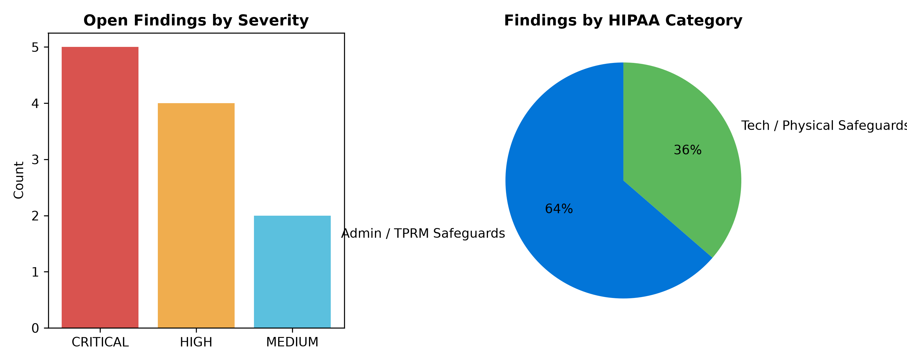

# Healthcare Continuous Compliance & Breach Triage Engine

[](https://github.com/BitJPByte/GRCHelper/actions/workflows/compliance_audit.yml)

**Automated Governance, Risk, and Compliance (GRC) & Technical Assurance for HIPAA, HITECH, 42 CFR Part 2, NIST SP 800-53 Rev. 5, and NIST CSF 2.0**

---

## Table of Contents
* [1. Executive Summary](#1-executive-summary)
* [2. Architecture & Continuous Monitoring Workflow](#2-architecture--continuous-monitoring-workflow)
* [3. Getting Started: Installation & Usage Guide (How-To)](#3-getting-started-installation--usage-guide-how-to)
* [4. Audit Deliverables & Executive Outputs](#4-audit-deliverables--executive-outputs)
* [5. Architectural Scalability: Lab vs. Production Environment](#5-architectural-scalability-lab-vs-production-environment)
* [6. Glossary of Terms & Regulatory Acronyms](#6-glossary-of-terms--regulatory-acronyms)

<br>

---

## 1. Executive Summary
* **The Problem:** Healthcare compliance programs frequently rely on static, point-in-time spreadsheets that quickly drift from real-world infrastructure, identity, and third-party vendor risks.
* **The Solution:** This repository implements an automated **Continuous Assurance & Breach Triage Engine** tailored for behavioral health and Substance Use Disorder (SUD) treatment environments. Using a **Policy-as-Data** architecture aligned with **NIST SP 800-66 Rev. 2** (*Implementing the HIPAA Security Rule*), the engine ingests technical telemetry across **KnowBe4**, **Microsoft Intune (MDM)**, **Microsoft Entra ID (M365)**, and **Third-Party Vendor (TPRM) BAA Inventories**, evaluating them dynamically against **HIPAA (45 CFR Part 164)**, **42 CFR Part 2**, **HITECH**, **NIST SP 800-53 Rev. 5**, and **NIST CSF 2.0**.
* **Audit-Ready Deliverables:** Automatically outputs a sanitized **Information Security Risk Register (POA&M)** in CSV format, visual severity/category compliance charts, a **CISO Executive Compliance Dashboard**, a **HITECH 4-Factor LoProCo Breach Triage Report**, and a cryptographic **SHA-256 integrity digest** guaranteeing tamper-evidence under **HIPAA 45 CFR § 164.312(c)(1)**.

<br>

---

## 2. Architecture & Continuous Monitoring Workflow

```text
+-----------------------------------------------------------------------------------+
|               EXTERNAL TELEMETRY & REGULATORY REFERENCE SOURCES                   |
+-----------------------------------------------------------------------------------+
   |                        |                         |                      |
   v                        v                         v                      v
[KnowBe4 API]       [MS Graph: Intune/Entra]   [TPRM & BAA JSON]    [NIST CPRT JSON Export]
- Phish Prone %     - BitLocker Encryption     - Active PHI Access  - SP 800-66 Rev. 2
- Overdue Training  - Conditional Access MFA   - Signed BAA Status  - SP 800-53 Rev. 5
- Repeat Clickers   - Endpoint Sensor Health   - SOC 2 / HITRUST    - NIST CSF 2.0
   |                        |                         |                      |
   |                        |                         |                      v
   |                        |                         |          [build_crosswalk_from_nist.py]
   |                        |                         |                      |
   |                        |                         |                      v
   |                        |                         |        (data/nist_hipaa_crosswalk.json)
   +------------------------+-------------------------+----------------------+
                                           |
                                           v
+-----------------------------------------------------------------------------------+
|                        HARDENED SECURITY LAYER (security_utils.py)                |
|  * HMAC-SHA256 PII Pseudonymization (HIPAA Minimum Necessary 45 CFR § 164.502(b)) |
|  * CSV Formula Injection (DDE) Neutralization (CWE-1236 / NIST SI-10)             |
|  * SSRF Host Allowlisting, HTTPS/TLS Enforcement & Path Traversal Jailing (CWE-22)|
|  * Automated Security Unit Test Suite (tests/test_security_utils.py)              |
+-----------------------------------------------------------------------------------+
                                           |
                                           v
+-----------------------------------------------------------------------------------+
|                      CORE COMPLIANCE & TRIAGE ENGINE (engine/)                    |
|  * continuous_compliance_auditor.py (Dynamic Crosswalk Lookup + Workforce/MDM/BAA)|
|  * hitech_breach_triage.py          (4-Factor LoProCo & Safe Harbor Triage)       |
+-----------------------------------------------------------------------------------+
                                           |
                                           v
+-----------------------------------------------------------------------------------+
|                            AUDIT-READY ARTIFACTS (output/)                        |
|  * live_hipaa_risk_register.csv    (+ SHA-256 Tamper-Evident Manifest)            |
|  * compliance_charts.png           (Automated Matplotlib Executive Visuals)       |
|  * ciso_executive_dashboard.md     (Executive Summary, CAP & POA&M Tracking)      |
|  * hitech_loproco_triage_report.md (HITECH Safe Harbor & 60-Day OCR Clock Triage) |
+-----------------------------------------------------------------------------------+
```

<br>

### Policy-as-Data & Automated Crosswalk ETL (`data/nist_hipaa_crosswalk.json`)
Rather than hardcoding statutory citations and control numbers inside Python evaluation loops, the engine uses a decoupled policy reference catalog:
* **Separation of Concerns:** Audit logic evaluates operational telemetry independently of regulatory text. Updates to federal mandates or control mappings require zero modifications to core Python execution code.
* **Automated Federal Catalog Ingestion (`scripts/build_crosswalk_from_nist.py`):** Ingests official machine-readable JSON exports directly from the **NIST Cybersecurity and Privacy Reference Tool (CPRT)** (`SP 800-66 Rev. 2`) and compiles them into the runtime crosswalk schema while preserving active telemetry rule bindings.
* **Multi-Framework Coverage:** Maps every finding simultaneously across **HIPAA Security/Privacy/Breach Rules**, **42 CFR Part 2**, **NIST SP 800-53 Rev. 5**, and **NIST CSF 2.0** (including `GV.SC` Supply Chain Risk Management).

<br>

---

## 3. Getting Started: Installation & Usage Guide (How-To)

### Prerequisites & Dependencies
This engine is designed with a minimal external attack surface and relies primarily on the **Python Standard Library**, plus `matplotlib` for generating executive charts.

* **Runtime:** Python `3.10+` (Tested up to Python `3.14` / `3.15`)
* **Built-in Standard Libraries Used:** `json`, `csv`, `hashlib`, `hmac`, `os`, `pathlib`, `urllib.parse`, `unittest` (Included with Python; no installation required)
* **External Third-Party Library:** `matplotlib` (Used to render `compliance_charts.png`)
* **Recommended Tools:** Visual Studio Code (with Markdown Preview enabled) and Git.

### Repository Directory Structure
```text
GRCHelper/
├── .github/
│   └── workflows/
│       └── compliance_audit.yml      # Automated GitHub Actions CI/CD & Daily Cron Pipeline
├── data/
│   ├── knowbe4_api_mock.json         # Simulated Workforce, Intune MDM, & Entra ID telemetry
│   ├── tprm_api_mock.json            # Simulated Third-Party Vendor BAA & SOC 2/HITRUST inventory
│   ├── nist_hipaa_crosswalk.json     # Active Policy-as-Data regulatory crosswalk catalog
│   └── raw_nist_800_66_export.json   # Official NIST CPRT JSON export (SP 800-66 Rev. 2)
├── docs/
│   └── images/
│       └── compliance_charts.png     # Static chart preview for repository documentation
├── engine/
│   ├── continuous_compliance_auditor.py  # Main compliance auditing & dashboard generation engine
│   ├── hitech_breach_triage.py           # 4-Factor LoProCo & HITECH Safe Harbor breach triage engine
│   └── security_utils.py                 # Hardened security controls (HMAC, DDE, SSRF, CWE-22)
├── scripts/
│   └── build_crosswalk_from_nist.py  # Automated ETL parser for NIST CPRT JSON exports
├── tests/
│   └── test_security_utils.py        # Unit test suite verifying CWE-22, CWE-1236, & HMAC controls
├── output/                           # Generated Risk Register CSV, PNG charts, & Dashboards (Git-ignored)
├── requirements.txt                  # Python package dependencies
└── README.md
```

### Step-by-Step Execution Guide

#### Step 1: Clone the Repository & Install Dependencies
Open your terminal (PowerShell, Bash, or VS Code Terminal) from the project root directory and install `matplotlib`:

```powershell
# Install via requirements.txt
python -m pip install -r requirements.txt

# Or install matplotlib directly
python -m pip install matplotlib
```

#### Step 2: Run the Automated Security Unit Tests
Verify that all defensive security controls (HMAC pseudonymization, CSV formula injection neutralization, path traversal jailing, and SSRF host validation) pass before running the audit:

```powershell
python -m unittest discover -s tests -v
```

#### Step 3: (Optional) Set Your Custom Pseudonymization Salt
To enforce the **HIPAA Minimum Necessary Standard (45 CFR § 164.502(b))**, raw employee IDs are pseudonymized via keyed `HMAC-SHA256`. In production, this salt is injected from a secret manager (e.g., Azure Key Vault). Locally, you can set an environment variable before running the audit:

```powershell
# PowerShell
$env:GRC_AUDIT_SALT="my-secure-organization-salt-2026"

# Linux / macOS
export GRC_AUDIT_SALT="my-secure-organization-salt-2026"
```
*(If not set, the engine safely defaults to an ephemeral lab salt for local testing.)*

#### Step 4: (Optional) Rebuild or Refresh the Regulatory Crosswalk from NIST JSON
To compile or refresh `data/nist_hipaa_crosswalk.json` from the official NIST CPRT JSON export (`data/raw_nist_800_66_export.json`), run the ETL parser:

```powershell
python scripts/build_crosswalk_from_nist.py
```

#### Step 5: Run the Continuous Compliance & Breach Triage Engines
Execute the core auditing engine and the 4-Factor HITECH Breach Triage script from the root of the repository:

```powershell
# 1. Run the Continuous Compliance & BAA Auditor
python engine/continuous_compliance_auditor.py

# 2. Run the HITECH 4-Factor LoProCo Breach Triage Engine
python engine/hitech_breach_triage.py
```

**Expected Terminal Output:**
```text
Audit completed. Generated Risk Register and CISO Dashboard in /output with hash ed52cbcb0ac638a7...
HITECH 4-Factor LoProCo Triage completed. Report saved to /output with hash 4e77139db83d776a...
```

#### Step 6: Review Audit-Ready Deliverables
Open the locally generated `output/` folder to inspect your compliance artifacts:
1. **`output/ciso_executive_dashboard.md`**: Executive summary table, embedded visual charts, SHA-256 tamper-evident hash, and itemized POA&M findings.
2. **`output/live_hipaa_risk_register.csv`**: Sanitized against CSV Formula Injection (DDE) and ready for import into Excel, ServiceNow GRC, or Jira.
3. **`output/hitech_loproco_triage_report.md`**: Automated HITECH Encryption Safe Harbor & 4-Factor LoProCo breach notification triage matrix.
4. **`output/compliance_charts.png`**: High-resolution (`300 DPI`) bar and pie charts breaking down open findings by severity and HIPAA safeguard category.

<br>

---

## 4. Audit Deliverables & Executive Outputs

*(Note: In accordance with **HIPAA Data Minimization** best practices, runtime `output/` artifacts are excluded via `.gitignore` to prevent accidental commit of live audit telemetry. Below is a preview of the generated artifacts from the mock dataset.)*

### A. Executive Visual Dashboard (`compliance_charts.png`)
The engine generates automated data visualizations summarizing risk posture for board-level and executive review:



<br>

### B. Live Information Security Risk Register (`live_hipaa_risk_register.csv`)
A sanitized, DDE-hardened CSV export ready for import into enterprise GRC systems (e.g., ServiceNow GRC, OneTrust, Jira):

| Rule ID | Severity | HIPAA Citation | NIST SP 800-53 | NIST CSF 2.0 | Asset / Vendor | Core Risk Finding | Remediation Guidance (POA&M) |
| :--- | :--- | :--- | :--- | :--- | :--- | :--- | :--- |
| `CHECK_C_ENDPOINT_ENCRYPTION` | **CRITICAL** | 45 CFR § 164.312(a)(2)(iv) | `SC-28, MP-4` | `PR.DS-01` | `id_a1c1c37ee09e` | Unencrypted endpoint accessing ePHI; voids HITECH Safe Harbor | Enforce Intune BitLocker policy & block M365 access |
| `CHECK_D_PART2_SUD_BREACH_RISK` | **CRITICAL** | 42 CFR Part 2 & 45 CFR § 164.404 | `IR-6, SC-28` | `RS.MA-01` | `id_b3cc7a729861` | Endpoint with 42 CFR Part 2 SUD access lacks disk encryption | Isolate host via Defender XDR & initiate 4-Factor LoProCo triage |
| `CHECK_E_MISSING_BAA` | **CRITICAL** | 45 CFR § 164.502(e) | `SA-9, AC-20` | `GV.SC-06` | `VEND-202` | Third-party ePHI vendor lacking signed BAA | Suspend vendor API/data access pending legal agreement |
| `CHECK_A_PHISHING_MFA` | **HIGH** | 45 CFR § 164.308(a)(5)(ii)(B) | `AT-2, IA-2(1)` | `PR.AA-01` | `id_1f07bfc30e23` | Repeat phish clicker with SUD/Part 2 access lacking strict MFA | Require remedial KnowBe4 module & apply Entra ID MFA policy |
| `CHECK_F_VENDOR_ASSURANCE` | **HIGH** | 45 CFR § 164.308(a)(1)(ii)(B) | `SA-9, RA-3` | `GV.SC-07` | `VEND-203` | Vendor processing ePHI lacks current SOC 2 / HITRUST CSF | Request updated SOC 2 Type II attestation report |
| `CHECK_B_OVERDUE_TRAINING` | **MEDIUM** | 45 CFR § 164.308(a)(5)(i) | `AT-2, AC-2` | `PR.AT-01` | `id_a1c1c37ee09e` | Annual HIPAA workforce training >14 days overdue | Escalate to manager via API; suspend EHR access after 30d |

> **Tamper-Evident Verification (HIPAA § 164.312(c)(1)):**  
> Each run generates a SHA-256 hash manifest verifying that output artifacts have not been modified post-audit:  
> `SHA-256 Digest: ed52cbcb0ac638a7c2901c5678eb178b671ec44f0b2f568a0a86377747738f6b`

<br>

### C. HITECH 4-Factor LoProCo Breach Triage Matrix (`hitech_loproco_triage_report.md`)
Evaluates endpoints handling ePHI and **42 CFR Part 2 Substance Use Disorder (SUD)** records against the statutory **HITECH Encryption Safe Harbor** and the **4-Factor LoProCo test (`45 CFR § 164.402`)** to determine whether the mandatory **60-day HHS/OCR breach reporting clock** is triggered:

| Asset ID | Department | Safe Harbor | Factor 1: PHI / Part 2 Scope | Factor 4: Mitigation Status | Legal Determination | 60-Day OCR Clock |
| :--- | :--- | :--- | :--- | :--- | :--- | :--- |
| `id_1f07bfc30e23` | Clinical Admissions (SUD) | YES (Encrypted) | Secured via NIST-compliant Full-Disk Encryption (BitLocker). | Complete - Verified Intune BitLocker key escrow. | **EXEMPT (HITECH Safe Harbor - No OCR Notification Required)** | Not Triggered |
| `id_b3cc7a729861` | Clinical Admissions (SUD) | **NO (Unencrypted)** | CRITICAL (42 CFR Part 2 SUD Clinical/Diagnostic Records) | INSUFFICIENT (No BitLocker Full-Disk Encryption; Remote Wipe Pending) | **PRESUMED REPORTABLE BREACH (45 CFR § 164.404 & 42 CFR Part 2)** | **ACTIVE (60 Days)** |
| `id_a1c1c37ee09e` | Patient Billing | **NO (Unencrypted)** | HIGH (Standard ePHI / Clinical Records) | INSUFFICIENT (No BitLocker Full-Disk Encryption; Remote Wipe Pending) | **PRESUMED REPORTABLE BREACH (45 CFR § 164.404 & 42 CFR Part 2)** | **ACTIVE (60 Days)** |

<br>

### D. CISO Executive Markdown Briefing (`ciso_executive_dashboard.md`)
A standalone briefing document formatted for executive review, tracking control maturity, Corrective Action Plans (CAP), and itemized POA&M milestones.

<details>
<summary><b>▶ Click to Expand Sample CISO Executive Briefing Output</b></summary>
<br>

#### Sample Finding Entry from `output/ciso_executive_dashboard.md`:
* **Finding 1: [CRITICAL] 45 CFR § 164.312(a)(2)(iv) & § 164.310(d)(1) (`CHECK_C_ENDPOINT_ENCRYPTION`)**
  * **Asset / Vendor:** `id_a1c1c37ee09e` (Patient Billing)
  * **Safeguard Category:** Technical & Physical Safeguard
  * **NIST 800-53 Rev. 5 Control:** `SC-28, MP-4` | **NIST CSF 2.0:** `PR.DS-01, PR.IR-01`
  * **Issue:** Endpoint accessing ePHI is unencrypted in Intune MDM. Voids HITECH Breach Safe Harbor if lost/stolen.
  * **Remediation Plan:** Enforce Intune BitLocker XTS-AES 256 compliance policy immediately and block M365/EHR session via Conditional Access until encrypted.

</details>

<br>

---

## 5. Architectural Scalability: Lab vs. Production Environment

| Component | Lab Implementation (Zero Cost / Dev) | Production: Less Complex / Budget-Friendly | Production: Complex / Enterprise Scale |
| :--- | :--- | :--- | :--- |
| **Data Ingestion & Telemetry** | Static local JSON files (`knowbe4_api_mock.json`, `tprm_api_mock.json`) parsed via Python & GitHub Actions cron. | Scheduled PowerShell scripts or Azure Logic Apps querying APIs; logs saved to restricted SharePoint or SQL. | Real-time event streaming via **Microsoft Sentinel** connectors, Azure Event Hubs, and OAuth 2.0 API webhooks. |
| **Regulatory Framework Mapping** | Local Policy-as-Data JSON catalog (`nist_hipaa_crosswalk.json`) built via Python ETL script. | Centralized SharePoint / Excel crosswalk matrices or UCF spreadsheets ingested via Power Automate. | Enterprise GRC platform (**ServiceNow GRC**, **OneTrust**, **Archer**) with live regulatory feeds & control inheritance. |
| **PII Protection & Secrets** | Local `HMAC-SHA256` function with environment variable / fallback salt in `security_utils.py`. | Local `.env` variables / basic secret storage; restricted HR mapping shares with strict NTFS/SharePoint permissions. | Managed secrets in **Azure Key Vault** with automated rotation; re-identification secured via **Microsoft Purview** & **Entra ID PIM**. |
| **Endpoint & 42 CFR Part 2 Enforcement** | Custom Python conditional checks & `hitech_breach_triage.py` evaluating encryption and MFA flags. | Native **Microsoft Intune** Device Compliance Policies combined with **Entra ID Conditional Access** auto-blocking. | Automated SOAR playbooks via **Microsoft Defender XDR** and **ServiceNow** triggering instant host isolation & Sev-1 tickets. |
| **Audit Reporting & Tamper Evidence** | Python script generating CSV risk register and stamping SHA-256 digest into Markdown dashboard. | Monthly audit reports saved to locked-down OneDrive/SharePoint repository with **Version History** & **Retention Labels**. | Writing compliance artifacts directly to **Azure Blob Storage with Immutable Storage (WORM)** policies for federal auditors. |

<br>

---

## 6. Glossary of Terms & Regulatory Acronyms

To ensure cross-functional alignment between engineering, legal, clinical operations, and executive leadership, this section defines key compliance frameworks, governance artifacts, and regulatory acronyms used throughout this engine:

| Acronym / Term | Full Name / Regulatory Scope | Plain-Language Definition & Operational Impact |
| :--- | :--- | :--- |
| **BAA** | Business Associate Agreement (HIPAA 45 CFR § 164.502(e) / § 164.504(e)) | A legally binding contract required between a covered healthcare entity and an external vendor/subcontractor handling ePHI. It legally binds the vendor to implement administrative, physical, and technical safeguards. |
| **POA&M** | Plan of Action and Milestones (NIST SP 800-53 CA-5) | A structured management document that identifies security tasks, required resources, remediation milestones, and scheduled completion dates for known vulnerabilities or compliance gaps. |
| **CAP** | Corrective Action Plan (HHS / OCR Enforcement) | A formal remediation strategy mandated by executive leadership or regulatory oversight bodies (like the HHS Office for Civil Rights) outlining the precise root-cause fixes for policy or audit failures. |
| **SRA** | Security Risk Assessment (HIPAA 45 CFR § 164.308(a)(1)(ii)(A)) | The foundational HIPAA requirement to conduct an accurate and thorough assessment of the potential risks and vulnerabilities to the confidentiality, integrity, and availability of electronic PHI held by an organization. |
| **ePHI** | Electronic Protected Health Information | Individually identifiable health information transmitted or maintained in electronic media (e.g., medical records, lab results, billing history). |
| **42 CFR Part 2** | Confidentiality of Substance Use Disorder Patient Records | Strict federal regulations protecting medical and diagnostic records related to substance use disorder (SUD) diagnosis, treatment, and referral. Unauthorized disclosure carries heightened penalties and strict consent rules beyond standard HIPAA. |
| **HITECH Act** | Health Information Technology for Economic and Clinical Health Act | Legislation establishing strict breach notification requirements (45 CFR §§ 164.400–414), creating mandatory 60-day breach reporting windows to HHS/OCR, and establishing the **Breach Safe Harbor** for NIST-approved encrypted data. |
| **LoProCo** | Low Probability of Compromise (45 CFR § 164.402) | The four-factor legal breach triage test used by privacy officers and incident responders to determine whether an unauthorized acquisition, access, use, or disclosure of ePHI requires mandatory government/patient notification. |
| **TPRM** | Third-Party Risk Management (NIST SP 800-53 SA-9 / CSF 2.0 GV.SC) | The continuous process of vetting, assessing, monitoring, and mitigating security risks introduced by external software vendors, service providers, and contractors. |
| **DDE** | Dynamic Data Exchange (CWE-1236 / CSV Formula Injection) | An attack vector where malicious formulas (starting with `=`, `+`, `-`, or `@`) are placed in plain-text records so that opening an exported CSV in spreadsheet software (like Microsoft Excel) triggers automatic command execution. |
| **WORM** | Write Once, Read Many (HIPAA 45 CFR § 164.312(c)(1)) | Immutable data storage architecture preventing records or audit logs from being modified, overwritten, or deleted during their retention lifecycle, ensuring non-repudiation for federal auditors. |
